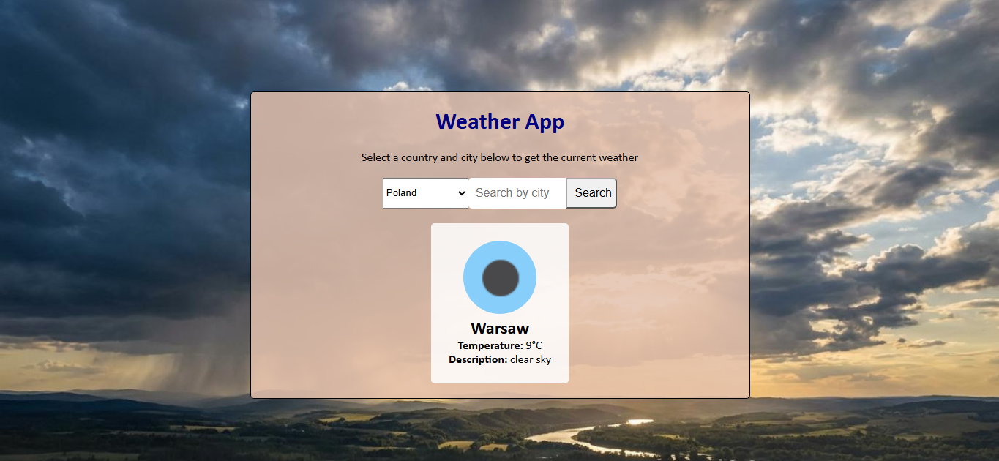

# Weather App

  

## Overview
This is a **Weather app* powered by the Open Weather API that allows you to get the current weather in different cities in the United Kingdom, United States, Germany, Poland and several other countries.

It uses Vanilla HTML, CSS and JavaScript, with the JavaScript processing the user's input to invoke a custom defined function that calls the Open Weather API.

## Project Structure
```
weather-app/
├── script.js          # JavaScript file for fetching weather data
├── styles.css         # CSS file for styling the app
├── index.html         # HTML file with core structure for app
└── warsaw-example.png # Screenshot of the weather app being used
```
# Note, you can get your own API Key from https://openweathermap.org/api. You can change the empty "" in the script.js file to your own API Key.